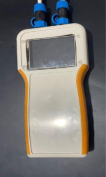

# Smart Power Monitor

Handheld energy monitor that watches a refrigerator (or any AC appliance), flags **abnormal idle consumption** ("energy waste"), tracks compressor cycles, and sends alerts to a phone through Blynk.

Mini-project, ISET Nabeul, ELNI21, 2025/2026 — Hammami Aymen, Gharbi Mohamed Wassim.

## How it works

| State | Rule |
|---|---|
| Compressor ON | power >= 100 W (turns off below 80 W, hysteresis) |
| Standby OK | idle, power <= 50 W |
| Energy waste | idle but power > 50 W for 30 s straight |

It also counts compressor cycles per hour and their average duration, and reports anomalies (more than 15 cycles/h, or cycles longer than 10 min). Thresholds are placeholders: calibrate them on your appliance (constants at the top of the sketch).

## Hardware

- CYD ESP32-2432S028 (ESP32 + 2.8" ILI9341 320x240 display)
- PZEM-004T v3.0, 100 A version with CT clamp (UART, 9600 baud)

| PZEM | CYD |
|---|---|
| GND | GND |
| 5V | 5V |
| PZEM TX | IO27 (ESP32 RX) |
| PZEM RX | IO22 (ESP32 TX) |

The CT clamp goes around the live wire only. L and N terminals connect directly to mains. **Mains voltage is dangerous: work with the supply unplugged and use an insulated enclosure.**

## Build

1. Arduino IDE, board **ESP32 Dev Module**, upload speed 115200 if you get checksum errors.
2. Libraries: `TFT_eSPI`, `PZEM004Tv30`, `Blynk`.
3. Copy `config/User_Setup.h` over `Arduino/libraries/TFT_eSPI/User_Setup.h`.
4. In `firmware/smart_power_monitor/`, copy `secrets.example.h` to `secrets.h` and fill it in (it is git-ignored).
5. In your Blynk template, create the events `energy_waste`, `compressor_anomaly`, `hourly_report` and datastreams V0-V9:
   V0 voltage, V1 current, V2 power, V3 energy kWh, V4 frequency, V5 power factor, V6 wasted Wh, V7 state (string), V8 cycles/h, V9 avg cycle min.
6. Upload.

## Status

Firmware written; hardware validation (real PZEM readings, waste alert end-to-end) is in progress. See `docs/Rapport_Mini_Projet.docx` for the full report.

## Roadmap

Predictive maintenance from cycle history, SD logging, electricity cost estimate, touch UI, OTA updates.
